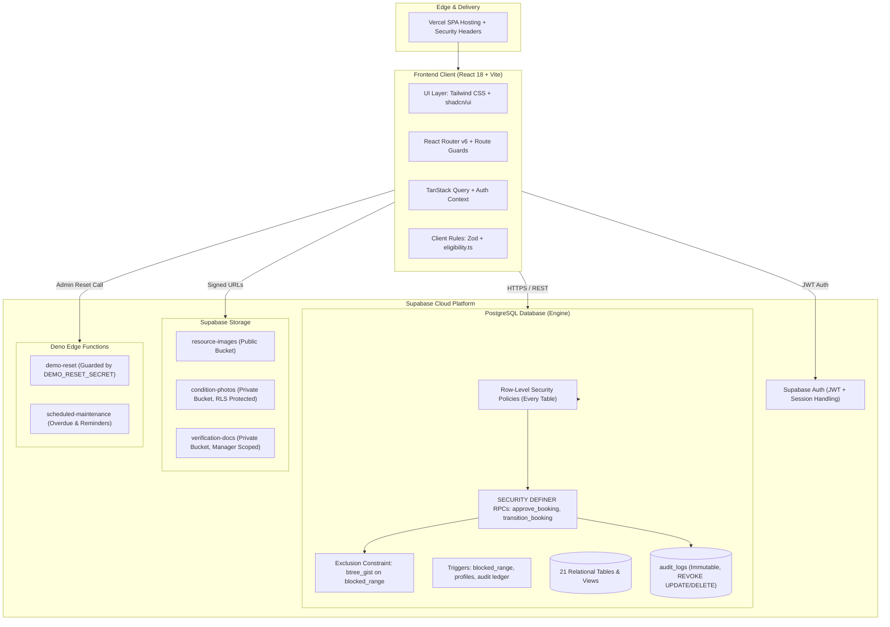
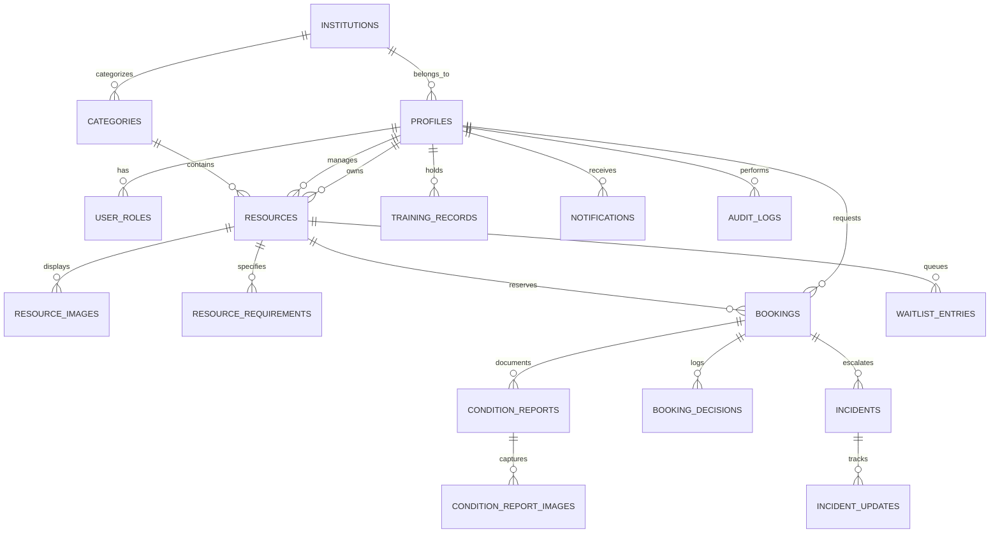

# ShareGrid Architecture

> Access more. Own less. Share responsibly.

ShareGrid is an institutional resource-sharing platform engineered with a Postgres-first security model, strict Role-Based Access Control (RBAC), database-level exclusion constraints for conflict prevention, and an append-only audit trail.

---

## High-Level System Architecture



---

## Database Schema & ER Relationships



---

## Core Security & Reliability Guarantees

### 1. Conflict Prevention at the Database Level
Rather than relying on asynchronous application-level checks that are vulnerable to race conditions:
1. Every booking maintains a `blocked_range` `tstzrange` column computed as `[start_time - buffer, end_time + buffer)`.
2. PostgreSQL's `btree_gist` extension enforces an exclusion constraint:
   ```sql
   ALTER TABLE bookings ADD CONSTRAINT exclude_overlapping_active_bookings
   EXCLUDE USING gist (
     resource_id WITH =,
     blocked_range WITH &&
   )
   WHERE (status IN ('APPROVED', 'CHECKED_IN', 'RETURN_PENDING_INSPECTION', 'OVERDUE', 'INCIDENT_REPORTED'));
   ```
3. Approvals execute within a `SECURITY DEFINER` function `approve_booking(booking_id, note)` that locks the row via `FOR UPDATE` and re-evaluates eligibility.

### 2. Zero-Trust Eligibility Engine
Uploaded certificates are never automatically trusted. Before a booking can be requested or approved:
- The system evaluates institutional membership, active non-expired training qualifications, account verification, and the user's 30-day rolling usage cap.
- Submissions require explicit verification decisions recorded by lab managers in `eligibility_reviews`.

### 3. Strict Row-Level Security (RLS)
- Requesters can only select and modify their own bookings and training records.
- Resource owners and managers can view requests and condition reports only for resources they own or supervise.
- Precise locker codes, entry keys, and supervisor phone numbers are hidden from public resource views and are only unlocked upon active check-in.

### 4. Immutable Audit Ledger
The `audit_logs` table records actor ID, action name, entity ID, human-readable explanations, and before/after JSON states. PostgreSQL `REVOKE UPDATE, DELETE ON audit_logs FROM PUBLIC, authenticated, anon` ensures logs cannot be modified or purged by any client role.
